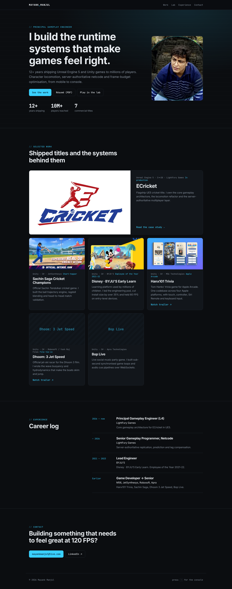

# Rebuild proposal (slice)

A proposed rebuild of the portfolio on **Astro**, served from **Cloudflare Workers static assets** as today. This folder is a working slice to react to: the home page, one case study (ECricket) and one Lab demo (client-side prediction). The live site in the repo root is untouched.



## Why

| Today | Rebuild |
| --- | --- |
| One 106 KB `index.html`, everything hand-wired | Pages, components and one Markdown file per project |
| Whole repo is the asset dir, so README, `wrangler.toml` and `functions/` are public | Only `dist/` is served |
| Missing URLs return the home page (SPA fallback) | Real 404 page with a 404 status |
| 16 MB of raw PNG/JPG (one 2.3 MB screenshot) | Responsive WebP generated at build, 2.3 MB → 29–205 KB |
| All demos load on first paint | Each demo is its own page and only runs while on screen |

## Run

```bash
cd rebuild
npm install
npm run dev        # http://localhost:4321
npm run build      # outputs dist/
npx wrangler deploy  # uses wrangler.jsonc, serves dist/ only
```

Or connect the repo in Cloudflare (Workers → Settings → Builds) with root `rebuild`, build `npm run build`, deploy `npx wrangler deploy`.

## Adding a project

Drop a Markdown file in `src/content/projects/`. Set `caseStudy: true` to give it its own page; the body becomes the write-up.

## To check before going further

- Copy is edited down from the current site. The ECricket "results" numbers (120 FPS, zero per-frame allocations) are from the current site's claims; please confirm them.
- Projects without screenshots (Dhoom 3, Bop Live) use a placeholder tile.
- Remaining demos (buoyancy, ballistics, ragdoll, StateTree) and the other case studies are the next step if this direction works.
